# 桌面环境备忘

换发行版或者换桌面的时候用。里面有 niri、Hyprland、GNOME，以及各发行版要装的包。`setup.sh` 会先问你要哪一套，改文件之前列出将要动什么，你输入 `y` 才继续。已有配置会按时间戳备份。

## 桌面

| 目录 | 是什么 |
| --- | --- |
| [desktops/niri-shorin](./desktops/niri-shorin) | niri，窗口规则来自 [SHORiN-KiWATA](https://github.com/SHORiN-KiWATA)。带模糊，和 DMS 一起用。依赖 `niri`、`fuzzel`、`dms` |
| [desktops/niri-vanilla](./desktops/niri-vanilla) | niri 官方默认配置，没有额外脚本。依赖 `niri`、`xwayland-satellite` |
| [desktops/dms](./desktops/dms) | Dank Miau Shell，顶栏和侧边控制，附一份 Firefox CSS |
| [desktops/hyprland](./desktops/hyprland) | Hyprland，Catppuccin 边框，Hyprlock / Waybar |
| [desktops/gnome](./desktops/gnome) | GNOME 暗色、手势、平铺快捷键 |
| [desktops/common-shell](./desktops/common-shell) | fish、starship、foot / kitty、yazi。哪个桌面都能用 |

## 发行版

| 系统 | 包怎么装 | 清单 |
| --- | --- | --- |
| Arch / Nyarch | pacman，AUR 用 yay 或 paru | [distros/arch/packages.txt](./distros/arch/packages.txt) |
| NixOS | flake / home-manager | [distros/nixos/flake.nix](./distros/nixos/flake.nix) |
| Fedora | dnf，niri 在 COPR `yalter/niri` | [distros/fedora/packages.txt](./distros/fedora/packages.txt) |
| Debian / Ubuntu | apt。niri / Hyprland 多半要自己编译 | [distros/debian-ubuntu/packages.txt](./distros/debian-ubuntu/packages.txt) |
| openSUSE Tumbleweed | zypper | [distros/opensuse/packages.txt](./distros/opensuse/packages.txt) |

## 跑脚本

```bash
git clone https://github.com/shenchuchu91-hub/Linux-Desktop-Matrix.git
cd Linux-Desktop-Matrix
./setup.sh
```

顺序是：

1. 认出当前发行版，回车确认，也可以改。
2. 选桌面，输入数字。
3. 列出源路径、要写到哪、备份放哪。输入 `y` 才动文件。

菜单里的选项：

```text
[1] niri，Shorin 那套窗口规则
[2] niri 官方默认配置
[3] DMS
[4] Hyprland
[5] GNOME
[6] 只装终端这套：fish、starship、foot / kitty、yazi
[7] 把配置都拉下来，不改 ~/.config
[0] 退出
```

两套 niri 不要叠在一起用。

Shorin 那套从 niri 25.11 起拆成 `layout.kdl`、`animations.kdl`、`blur.kdl`。`shorin-windowrules.kdl` 里是 QQ、微信、Steam 弹窗、Polkit 窗口的浮动和居中。启动时会拉起 `dms-launch.sh`。

官方那套就是 `default-config.kdl`，键位跟上游文档一致，没有外壳脚本。

## NixOS

`flake.nix` 里加这个输入：

```nix
{
  inputs = {
    nixpkgs.url = "github:nixos/nixpkgs/nixos-unstable";
    home-manager.url = "github:nix-community/home-manager";
    desktop-matrix.url = "github:shenchuchu91-hub/Linux-Desktop-Matrix";
  };

  outputs = { self, nixpkgs, home-manager, desktop-matrix, ... }: {
    nixosConfigurations.my-workstation = nixpkgs.lib.nixosSystem {
      system = "x86_64-linux";
      modules = [
        ./configuration.nix
        desktop-matrix.nixosModules.desktopMatrix
      ];
    };
  };
}
```

`desktopMatrix` 打开 Wayland、PipeWire、中文字体和依赖。桌面本身在 `home.nix` 里选一个：

```nix
{ config, pkgs, ... }:

{
  imports = [
    "${inputs.desktop-matrix}/distros/nixos/home-manager/niri.nix"
    # "${inputs.desktop-matrix}/distros/nixos/home-manager/hyprland.nix"
    # "${inputs.desktop-matrix}/distros/nixos/home-manager/gnome.nix"
  ];
}
```

## 备份和退回

写软链接之前，如果目标已经存在，会改名为：

```bash
~/.config/niri.backup.YYYYMMDD_HHMMSS
```

这次部署会在仓库根目录生成 `rollback.sh`：

```bash
./rollback.sh
```

链接是绝对路径。之后 `git pull`，桌面读到的就是新文件，不用再复制一遍。

## 目录

```text
Linux-Desktop-Matrix/
├── setup.sh
├── assets/
├── distros/
│   ├── arch/packages.txt
│   ├── nixos/
│   ├── fedora/packages.txt
│   ├── debian-ubuntu/packages.txt
│   └── opensuse/packages.txt
└── desktops/
    ├── niri-shorin/
    ├── niri-vanilla/
    ├── dms/
    ├── hyprland/
    ├── gnome/
    └── common-shell/
```

## 出处

窗口规则整理自 [SHORiN-KiWATA](https://github.com/SHORiN-KiWATA) 的 [shorin-niri](https://github.com/SHORiN-KiWATA/shorin-niri) 和 [shorin-dms-hyprniri](https://github.com/SHORiN-KiWATA/shorin-dms-hyprniri)。安装脚本参考了 [shorin-arch-setup](https://github.com/SHORiN-KiWATA/shorin-arch-setup)（AGPL-3.0）。

[trygveaa/kitty-kitten-search](https://github.com/trygveaa/kitty-kitten-search) 的 `desktops/common-shell/kitty/search.py` 是 GPL-3.0。

路径和许可证写在 [THIRD_PARTY_NOTICES.md](./THIRD_PARTY_NOTICES.md)。`shorin-niri`、`shorin-dms-hyprniri` 上游还没声明许可证，先留着并注明。要撤就说。

niri 本身是 [YaLTeR/niri](https://github.com/YaLTeR/niri)。Hyprland 是 Vaxry 的项目。

[MIT](./LICENSE) 只覆盖这个仓库里我自己写的部分。动的是 `~/.config`，生产机器上先看脚本列出来的备份路径。

<p align="center"><sub>雨还在下</sub></p>


