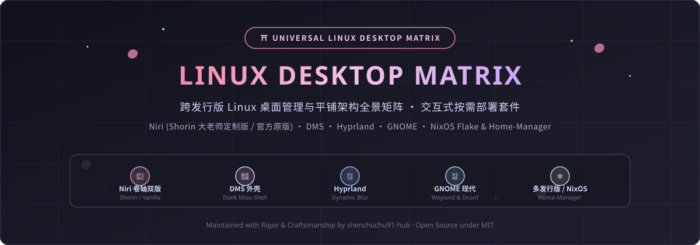

<div align="center">

  <!-- 本地自托管动态美学 Banner -->
  

  <br><br>

  <p align="center">
    
    
    
    
    
    
  </p>

  <p align="center">
    <i>跨发行版 Linux 桌面环境与平铺架构全景矩阵 · 终端交互式按需部署套件</i>
    <br>
    <sub>“架构严谨，选择自由。对标全平台 Linux，融汇 Arch、NixOS 与现代 Wayland 桌面美学。”</sub>
  </p>

</div>

---

## 📑 目录全景 (Table of Contents)

- [💡 项目初衷与架构定位 (Philosophy)](#-项目初衷与架构定位-philosophy)
- [📊 桌面管理与平铺方案全景矩阵 (Desktop Matrix)](#-桌面管理与平铺方案全景矩阵-desktop-matrix)
- [🖥️ 发行版兼容性对照 (Distro Compatibility)](#️-发行版兼容性对照-distro-compatibility)
- [🚀 终端交互式选择器 (Interactive Selector)](#-终端交互式选择器-interactive-selector)
  - [1. 快速克隆与交互式运行](#1-快速克隆与交互式运行)
  - [2. 明确的交互指引与选择机制](#2-明确的交互指引与选择机制)
  - [3. Niri 双版本深度对照与抉择](#3-niri-双版本深度对照与抉择)
- [❄️ NixOS 一等公民支持 (NixOS Flake & Home-Manager)](#️-nixos-一等公民支持-nixos-flake--home-manager)
  - [1. 声明式 Flake 引用](#1-声明式-flake-引用)
  - [2. Home-Manager 独立模块嵌入](#2-home-manager-独立模块嵌入)
- [🛡️ 安全备份、执行快照与一键回滚 (Safety & Rollback)](#️-安全备份执行快照与一键回滚-safety--rollback)
- [🌸 模块化仓库结构 (Repository Structure)](#-模块化仓库结构-repository-structure)
- [📜 致敬、免责声明与许可证 (Credits & Disclaimer)](#-致敬免责声明与许可证-credits--disclaimer)

---

## 💡 项目初衷与架构定位 (Philosophy)

在 Linux 生态中，桌面配置（Rice）往往存在两大痛点：
1. **与特定发行版严重绑定**：许多仓库仅适用于单一发行版，换到其他系统（尤其是如 NixOS 这类不可变系统或 Fedora/Debian）时配置往往失效或难以复现；
2. **缺乏明确的选择权与安全保障**：传统的配置仓库往往通过粗暴的覆盖脚本，强行替换用户的整个 `~/.config`，缺乏明确的交互提示与无损回滚机制。

作者在深度实践 **Arch Linux** 与 **NixOS** 系统的过程中，总结提炼出这一套 **`Linux-Desktop-Matrix`**：
- **全面对标所有主流 Linux 发行版**：涵盖 Arch Linux / Nyarch、NixOS、Fedora、Debian / Ubuntu、openSUSE；
- **全景整合 Wayland 现代桌面方案**：汇聚 **Niri**（提供大老师定制版与官方纯净版双轨）、**DMS**（Dank Miau Shell）、**Hyprland** 以及 **GNOME** 现代工作流；
- **终端交互明确，自主决定**：运行安装脚本时，系统会自动探测环境并以极度清晰、彩色的交互终端向用户询问“想部署哪个”，所有改动均带有时间戳备份与可逆回滚脚本。

---

## 📊 桌面管理与平铺方案全景矩阵 (Desktop Matrix)

下表全面列出本矩阵中各桌面环境与窗口管理器的定位、特性及适用场景：

| 模块名称 | 核心定位与布局哲学 | 视觉风格与特性 | 依赖要求 | 适用人群 | 对应目录 |
| :--- | :--- | :--- | :--- | :--- | :--- |
| **Niri (Shorin 定制版)** | **无限卷轴式平铺 (Scrollable Tiling)** | 大老师定制规则 (`shorin-windowrules.kdl`)、Kawase 模糊、DMS 深度联动 | `niri`, `fuzzel`, `dms` | 追求开箱即用二次元卷轴极致体验 | [`desktops/niri-shorin`](./desktops/niri-shorin) |
| **Niri (官方纯净原版)** | **官方标准参考架构 (Vanilla Upstream)** | 官方原生 `default-config.kdl`，无第三方脚本绑定，极简纯净 | `niri`, `xwayland-satellite` | 开发者、极简主义者、自主定制者 | [`desktops/niri-vanilla`](./desktops/niri-vanilla) |
| **DMS (Dank Miau Shell)** | **Wayland 桌面外壳与控制面板** | 二次元半透明面板、侧边快捷控制、匹配的 Firefox CSS 动态主题 | `quick-shell` / DMS runtime | 需要增强现有桌面顶栏与托盘控制 | [`desktops/dms`](./desktops/dms) |
| **Hyprland** | **现代流体动态平铺 (Dynamic Tiling)** | Catppuccin Sakura 渐变边框、双重 Kawase 模糊、Hyprlock/Waybar | `hyprland`, `waybar`, `hyprlock` | 钟情高刷新率流体动画与瓦片平铺 | [`desktops/hyprland`](./desktops/hyprland) |
| **GNOME** | **现代完整工作站工作流 (Stacked/DE)** | 沉浸式暗色模式、平铺边缘吸附、触控板手势、平铺快捷键映射 | `gnome-shell`, `gsettings` | 追求极致稳固与开箱即用大桌面生态 | [`desktops/gnome`](./desktops/gnome) |
| **Common Shell** | **通用生产力终端开发套件** | Fish 4.x + Starship 提示符 + Foot/Kitty 终端 + Yazi 文件管理器 | `fish`, `starship`, `yazi` | 跨所有桌面的轻量高效命令行环境 | [`desktops/common-shell`](./desktops/common-shell) |

---

## 🖥️ 发行版兼容性对照 (Distro Compatibility)

本矩阵针对以下主流发行版提供专门的包管理适配与部署逻辑：

| 发行版体系 | 包管理器 / 模式 | 推荐适配方式 | 对应配置说明 |
| :--- | :--- | :--- | :--- |
| **Arch Linux / Nyarch** | `pacman` · `AUR` (yay/paru) | 原生包完整支持，AUR 提供专属扩展工具 | [distros/arch/packages.txt](./distros/arch/packages.txt) |
| **NixOS** | `nix` · `home-manager` · `Flakes` | **一等公民声明式支持**，支持纯 Flake / Module 引入 | [distros/nixos/flake.nix](./distros/nixos/flake.nix) |
| **Fedora / RHEL** | `dnf` · `COPR` (yalter/niri) | 支持 COPR 仓库引入现代 Wayland 合成器 | [distros/fedora/packages.txt](./distros/fedora/packages.txt) |
| **Debian / Ubuntu** | `apt` · `Cargo` / 源码 | GNOME 完美适配，Niri/Hyprland 建议结合 Rust/Cargo | [distros/debian-ubuntu/packages.txt](./distros/debian-ubuntu/packages.txt) |
| **openSUSE** | `zypper` (Tumbleweed) | 滚动分支官方源全面收录 Wayland 现代套件 | [distros/opensuse/packages.txt](./distros/opensuse/packages.txt) |

---

## 🚀 终端交互式选择器 (Interactive Selector)

为了杜绝“静默覆盖”或“安装后不知改了什么”的工程隐患，本套件内置了完全交互式的选择器 [`setup.sh`](./setup.sh)。

### 1. 快速克隆与交互式运行

```bash
# 克隆仓库
git clone https://github.com/shenchuchu91-hub/Linux-Desktop-Matrix.git
cd Linux-Desktop-Matrix

# 启动交互式选择器 (安全非破坏性)
./setup.sh
```

### 2. 明确的交互指引与选择机制

在终端执行命令时，选择器会严格分步进行：
1. **发行版探测**：自动识别当前运行的 Linux（如 Arch、NixOS、Fedora 等），并允许用户敲击回车直接确认或按需覆盖；
2. **桌面明确选择**：列出清晰的菜单，用户明确输入数字选择对应的桌面；
3. **预检确认清单 (Pre-Flight Plan)**：在任何文件变动前，屏幕会清晰列出源路径、目标安装路径、自动备份路径及部署模式，需用户显式输入 `y` 才会继续。

```text
======================================================================
请明确选择您想要部署的桌面环境 / 窗口管理器：
======================================================================
  [1] Niri - Shorin (大老师) 深度定制版 (推荐)
      ▸ 特性: 独家包含大老师优化版 shorin-windowrules.kdl 智能规则、
              卷轴平铺流体动画、Kawase 高斯模糊与 DMS 外壳联动。
      ▸ 适用: 追求极致开箱即用二次元美学与卷轴操作体验。

  [2] Niri - 官方纯净原版 (Vanilla Upstream)
      ▸ 特性: 采用官方上游纯净 default-config.kdl 标准，零多余外部脚本，
              保留最原汁原味的上游默认架构与键位。
      ▸ 适用: 开发者、极简主义者或计划从零定制 KDL 的用户。

  [3] DMS (Dank Miau Shell)
      ▸ 特性: 现代化 Wayland 二次元桌面面板、侧边控制中心与配套 Firefox CSS。

  [4] Hyprland - 现代化流体平铺全套方案
      ▸ 特性: 动态瓦片平铺、Catppuccin Sakura 渐变边框、双重 Kawase 模糊、
              Hyprlock 锁屏、Hypridle 守护及专属 Waybar 顶栏。

  [5] GNOME - 现代工作站工作流优化
      ▸ 特性: 沉浸式暗色模式、触控板手势、平铺边缘吸附、快捷键映射与精选扩展清单。

  [6] 生产力终端运行时 (Common Shell Suite)
      ▸ 特性: Fish 4.x + Starship + Foot / Kitty + Yazi 文件管理器。

  [7] 全部拉取并检出 (Full Matrix Checkout)
      ▸ 特性: 完整下载所有桌面配置至当前目录，不改动 ~/.config 系统配置。

  [0] 退出安装 (Exit)
======================================================================
```

### 3. Niri 双版本深度对照与抉择

对于 Niri 卷轴式窗口管理器，本仓库特意设计了**两个互不干扰的独立分支**：

#### 方案 A：Shorin (大老师) 深度定制版 (`desktops/niri-shorin`)
- **核心模块拆分**：自 Niri 25.11 起支持模块化引入，包含 `layout.kdl`、`animations.kdl`、`blur.kdl`；
- **智能窗口规则**：内置大老师经受无数应用考验的 [`shorin-windowrules.kdl`](./desktops/niri-shorin/shorin-windowrules.kdl)，QQ、微信、Steam 弹窗、Polkit 授权窗均能精准以浮动或固定比例居中吸附；
- **外壳联动**：无缝拉起 Dank Miau Shell（`dms-launch.sh`）与音效联动脚本。

#### 方案 B：官方纯净原版 (`desktops/niri-vanilla`)
- **纯净上游标准**：基于官方 `default-config.kdl` 架构构建；
- **零额外依赖**：不预设外部 Shell 与自定义脚本，所有键位严格遵照官方默认文档；
- **开发者基座**：适合想要从零开始理解 Niri 原生语法、自主设计工作流的开发者。

---

## ❄️ NixOS 一等公民支持 (NixOS Flake & Home-Manager)

由于作者曾深度使用 NixOS，深刻体会到声明式配置在跨机器迁移中的优势。本套件对 NixOS 用户提供**原生声明式支持**，无需通过 Imperative 脚本污染系统。

### 1. 声明式 Flake 引用

在你的系统 `flake.nix` 中引入本仓库：

```nix
{
  inputs = {
    nixpkgs.url = "github:nixos/nixpkgs/nixos-unstable";
    home-manager.url = "github:nix-community/home-manager";
    
    # 引入 Linux-Desktop-Matrix 矩阵
    desktop-matrix.url = "github:shenchuchu91-hub/Linux-Desktop-Matrix";
  };

  outputs = { self, nixpkgs, home-manager, desktop-matrix, ... }: {
    nixosConfigurations.my-workstation = nixpkgs.lib.nixosSystem {
      system = "x86_64-linux";
      modules = [
        ./configuration.nix
        desktop-matrix.nixosModules.desktopMatrix # 开启基础 Wayland、PipeWire、CJK 字体与依赖
      ];
    };
  };
}
```

### 2. Home-Manager 独立模块嵌入

在你的 `home.nix` 中选择引入所需的桌面配置模块：

```nix
{ config, pkgs, ... }:

{
  imports = [
    # 自由挑选你想要的桌面模块：
    "${inputs.desktop-matrix}/distros/nixos/home-manager/niri.nix"     # Niri 模块
    # "${inputs.desktop-matrix}/distros/nixos/home-manager/hyprland.nix" # 或 Hyprland 模块
    # "${inputs.desktop-matrix}/distros/nixos/home-manager/gnome.nix"    # 或 GNOME 调优
  ];
}
```

---

## 🛡️ 安全备份、执行快照与一键回滚 (Safety & Rollback)

为了贯彻严谨的软件工程准则，本仓库的所有部署行为均遵循**“非破坏性原子更新”**：

1. **自动时间戳备份**：
   在任何目标配置（如 `~/.config/niri`）被创建软链接前，若原文件存在，脚本会自动将其重命名备份为：
   ```bash
   ~/.config/niri.backup.YYYYMMDD_HHMMSS
   ```
2. **一键逆向回滚脚本**：
   每次部署成功后，系统会在仓库根目录下动态生成一份针对本次操作的专用回滚脚本 [`rollback.sh`](./rollback.sh)：
   ```bash
   # 如需随时撤销本次部署并恢复历史配置，只需执行：
   ./rollback.sh
   ```
3. **软链接隔离模式**：
   采用标准绝对路径符号链接（Symlink），当你通过 `git pull` 更新本仓库后，桌面配置可实时无缝保持同步，无需重复执行复制。

---

## 🌸 模块化仓库结构 (Repository Structure)

```text
Linux-Desktop-Matrix/
├── LICENSE                      # MIT 开源许可证
├── README.md                    # 本全景工程架构与使用指南
├── setup.sh                     # 终端交互式选择器与部署总控
├── assets/
│   └── banner.svg               # 高清动态矢量美学横幅
├── distros/                     # 针对各主流发行版的专门依赖清单与指南
│   ├── arch/packages.txt        # Arch Linux / Nyarch 核心包
│   ├── nixos/                   # NixOS 声明式 Flake 与 Home-Manager 模块
│   │   ├── flake.nix
│   │   ├── default.nix
│   │   └── home-manager/        # 独立的 niri.nix / hyprland.nix / gnome.nix
│   ├── fedora/packages.txt      # Fedora / COPR 安装清单
│   ├── debian-ubuntu/packages.txt # Debian / Ubuntu 依赖清单
│   └── opensuse/packages.txt    # openSUSE Tumbleweed 依赖清单
└── desktops/                    # 各桌面环境与平铺架构独立解耦目录
    ├── niri-shorin/             # Shorin (大老师) 深度优化版 Niri 配置
    ├── niri-vanilla/            # Niri 官方纯净原版配置 (default-config.kdl)
    ├── dms/                     # Dank Miau Shell 二次元面板与 Firefox 主题
    ├── hyprland/                # Hyprland 现代流体平铺全套 (含 Waybar/Hyprlock)
    ├── gnome/                   # GNOME 现代工作流快捷键与扩展调优
    └── common-shell/            # 通用终端运行时 (Fish 4.x + Starship + Foot/Kitty + Yazi)
```

---

## 📜 致敬、免责声明与许可证 (Credits & Disclaimer)

### 致敬与灵感来源 (Credits)
- **SHORiN-KiWATA (Shorin 大老师)**：致敬大老师在 Arch Linux 与 Niri 平铺桌面领域的卓越工程实践，本项目中 `niri-shorin` 核心规则与窗口逻辑基于大老师的原创设计精心整理并保持模块化维护；
- **Niri Compositor Team**：感谢 YaLTeR 及 Niri 开源社区创造的杰出滚动平铺架构；
- **Hyprland & Vaxry**：感谢 Hyprland 社区对现代 Wayland 流体动态美学的开拓；
- **NixOS 社区**：感谢不可变声明式系统为现代 Linux 架构带来的启迪。

### 安全提示与免责声明 (Disclaimer)
本项目涉及底层桌面环境与用户配置目录的管理。尽管选择器内置了完备的时间戳备份与回滚机制，但在生产机器上操作前，仍建议用户阅读本账号通用准则：
- 🛡️ **[全局免责声明与安全守则 (Disclaimer)](https://github.com/shenchuchu91-hub/disclaimer)**

### 许可证 (License)
本项目采用 [MIT License](./LICENSE) 协议开源。
</div>
